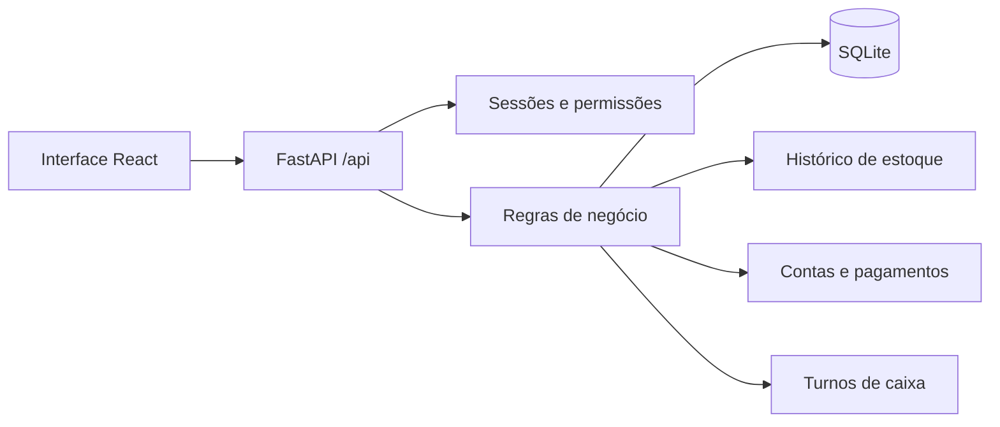

# Arquitetura e regras do MVP

## Organização

React 19 + TypeScript + Vite na interface; FastAPI + SQLAlchemy 2 + Alembic no backend; SQLite com chaves estrangeiras, WAL e timeout de 15 segundos. Frontend compilado e API usam a mesma origem. Desenvolvimento usa proxy `/api` do Vite.

`models.py` define entidades e restrições; `schemas.py` valida entradas; `services.py` concentra transações de negócio; `api.py` autentica, aplica permissões, consulta e exporta. O frontend não é autoridade para permissões ou saldos.

## Matriz de acesso

| Recurso | Administrador | Operador |
| --- | --- | --- |
| Clientes | Criar, consultar, editar, desativar | Criar, consultar, editar, desativar |
| Produtos / serviços | Gerenciar | Consultar e exportar |
| Estoque / financeiro | Gerenciar | Sem acesso à API administrativa |
| Usuários / auditoria | Gerenciar / consultar | Sem acesso |
| Vendas | Consultar todas; cancelar finalizadas antes do fechamento | Criar, consultar próprias, finalizar próprias; cancelar rascunhos próprios |
| Caixa | Abrir próprio; consultar/fechar turnos | Abrir, consultar e fechar próprio |
| Dashboard | Resumo geral | Próprias vendas e caixa; catálogo disponível |

Credenciais: Argon2; sessão opaca aleatória em cookie `HttpOnly`, `SameSite=Strict`, 12 horas; apenas hash do token no banco. Logout e desativação revogam sessões. O login limita oito falhas por IP/usuário a cada dez minutos. Hosts são restritos a loopback e mutações rejeitam origem externa. Sem CORS aberto.

## Representação exata

- Dinheiro: centavos inteiros; preço `101` representa R$ 1,01.
- Quantidade: milésimos inteiros; `1250` representa 1,25 unidades.
- Cada linha: `(preço_centavos * quantidade_milésimos + 500) // 1000`, arredondando meio centavo para cima.
- Desconto aplicado depois da soma das linhas. Total deve ser positivo e limitado a 100 bilhões de centavos.
- Preço, descrição e unidade são copiados para a linha da venda; edição do catálogo não muda esses registros.
- Horários armazenados em UTC e exibidos em America/Manaus. Vencimento é uma data local, sem conversão de fuso.

## Estoque e vendas

Uma gravação HTTP adquire `BEGIN IMMEDIATE` antes da leitura, serializando escritores SQLite. Finalizar venda modifica saldo, insere movimentos, cria conta e pagamento e altera a situação numa única transação. Falha em qualquer item reverte tudo; o rascunho permanece disponível. Isso também impede que duas vendas consumam o mesmo último saldo.

Uma venda possui no máximo uma conta financeira. Repetir a finalização de uma venda já finalizada retorna o registro existente, inclusive se os parâmetros repetidos forem diferentes: não cria novo pagamento nem muda a forma registrada. Para corrigir, use cancelamento autorizado e uma nova venda. Finalizar venda cancelada é rejeitado.

Serviços não movimentam estoque. Inventário recebe o saldo contado e grava a diferença. Saída não pode tornar saldo negativo. Saldo inicial só é aceito antes do primeiro movimento. O saldo do produto corresponde à soma do histórico. Não há exclusão física de clientes/itens; desativação preserva referências. O tipo produto/serviço não pode mudar depois de movimentação ou venda.

## Caixa e financeiro

Um turno aberto por usuário, garantido por índice único parcial. Abertura é fundo, não receita. Dinheiro esperado é fundo + soma dos pagamentos assinados vinculados ao turno. Pix/cartão usam contas bancárias e não alteram a gaveta. Saída e estorno em dinheiro não podem produzir saldo negativo.

Todas as vendas exigem o caixa do autor aberto, mesmo com Pix, cartão ou a prazo. No fechamento, esperado, contado e diferença ficam persistidos. Repetir fechamento retorna o fechamento original.

Venda a prazo exige cliente ativo e vencimento presente/futuro; gera recebível em aberto, sem pagamento. Títulos podem ser quitados total ou parcialmente. Cada baixa registra principal, juros, multa, desconto e valor líquido; uma chave de solicitação impede duplicação. Pagamento em dinheiro exige caixa de quem quita aberto e conta do tipo caixa; Pix/cartão/OFX exigem conta bancária. Saldo atual das contas é saldo inicial cadastrado + soma dos pagamentos assinados de todo o histórico; o fundo de troco do turno não entra nesse saldo. O saldo inicial não é receita do período.

Estorno preserva a baixa original e insere outro pagamento de valor e componentes opostos, com referência única `reversal_of` e motivo registrado. Estornar novamente não cria outro registro. Venda finalizada só pode ser cancelada pelo administrador enquanto seu turno original está aberto. Pagamento em dinheiro que pertence a um turno fechado não pode ser estornado. O cancelamento da venda devolve estoque e cancela sua conta. Contas ligadas a vendas não podem ser canceladas separadamente.

Situações financeiras: aberto, parcial, quitado, cancelado. Vencido é calculado (`aberto/parcial && vencimento < hoje`), não armazenado. Recorrência cria títulos separados, em série finita de até 60 ocorrências, com o mesmo valor em cada período; não parcela automaticamente um título ou uma venda.

## API

Contrato OpenAPI em `/api/openapi.json`, servido localmente sem depender de recursos de CDN.

- `/api/auth/login`, `/me`, `/logout`
- `/api/users` e `/{id}/toggle`
- `/api/customers`, `/api/products` (GET/POST/PUT)
- `/api/stock-movements`
- `/api/cash-sessions`, `/current`, `/{id}/close`
- `/api/sales`, `/{id}`, `/{id}/finalize`, `/{id}/cancel`
- `/api/accounts`, `/api/categories` (GET/POST/PUT)
- `/api/subcategories`, `/api/suppliers` (GET/POST/PUT)
- `/api/company-settings` (identidade provisória da empresa)
- `/api/service-orders`, `/{id}`, `/{id}/generate-titles`, `/{id}/cancel`
- `/api/finance/movements` (GET/POST), `/{id}/reverse`, `/api/finance/movements.csv`
- `/api/finance`, `/{id}/settle`, `/{id}/cancel`
- `/api/finance/print` e `/api/reports/finance.csv` aplicam o mesmo conjunto de filtros dos títulos
- `/api/finance/{id}/attachments`, `/api/finance/payments/{id}/attachments`, `/api/finance/attachments/{id}`
- `/api/finance/ofx/imports`, importações, sugestões e confirmação manual de linhas
- `/api/finance/dashboard`, `/api/finance/reports/catalog`, `/api/finance/reports/{slug}[.csv]`, `/api/finance/budgets`
- `/api/dashboard`, `/api/audit`, `/api/health`
- `/api/reports/{products|customers|stock|sales|finance}.csv`

Listagens têm paginação, pesquisa e filtros apropriados. CSV usa os mesmos filtros e todas as páginas; texto que pode ser fórmula de planilha é neutralizado. Dados de senha, tokens e corpos de validação não são retornados nos erros.

## Livro caixa e cadastros — Sprint 8

Este trecho descreve o estado ao final da Sprint 8. As ampliações implementadas nas Sprints 9–13 estão documentadas na seção seguinte.

`financial.py` reúne cadastros financeiros, movimentos e exportação. `/api/finance` continua sendo o cadastro de títulos: pendências não entram no livro caixa. `/api/finance/movements` consulta `Payment`, incluindo pagamentos de vendas, quitações e estornos; lançamento imediato cria título quitado e pagamento na mesma transação.

O valor do pagamento tem sinal. Receita é positivo; despesa, negativo. Um estorno é o movimento oposto, preservando o original e com data de lançamento de hoje; conserva a competência original. Os cards agregam **todos** os movimentos do filtro antes da paginação, incluindo estornos. O saldo atual dos chips independe do período e da busca.

Datas de lançamento e competência são datas locais separadas. Conta bancária aceita lançamento até hoje, respeitando a referência de seu saldo inicial; dinheiro exige hoje e caixa do usuário aberto. Competência pode ser diferente. Os períodos rápidos usam calendário de Manaus, semana de segunda a domingo e meses/anos completos. Campos de filtro são um rascunho até Pesquisar; períodos rápidos e chips são atalhos diretos para data e conta, preservando os demais filtros já aplicados.

Uma chave de pedido estável no formulário impede duplicação por repetição/concorrência. Repetição com os mesmos dados retorna o pagamento original; a mesma chave com outros dados retorna 409. A reversão de um lançamento manual é idempotente. Pagamentos ligados a vendas/títulos devem ser corrigidos pelo fluxo de origem.

Categoria define receita/despesa/ambas, operacional/investimento/financiamento e grupo de resultado. Subcategoria define vínculo e incidência no resultado. Fornecedor é opcional nas despesas. Cadastros inativos continuam no histórico e filtros, mas não podem ser usados em novos lançamentos. Não há exclusão física. Tipo/saldo inicial/referência de contas com histórico, direção de categoria usada e categoria de subcategoria usada ficam protegidos contra alteração.

Taxas usam centésimos de ponto percentual (`150` = 1,50%). Na Sprint 8 estavam cadastradas sem aplicação automática; quitação parcial, encargos e anexos foram adicionados na Sprint 10.

Migração 0003 acrescenta campos e tabelas sem recriar títulos/pagamentos. Campos antigos, IDs e valores permanecem. Datas antigas usam timestamp UTC convertido para Manaus; categorias recebem subcategoria Geral. Retrocesso usa backup anterior e código compatível com 0002; não se executa downgrade destrutivo. CSV contém todas as páginas do filtro; impressão prepara todas as páginas e o navegador exibe somente o relatório. Não foi validada impressora física.

## Expansão — Sprints 9–13

O ciclo seguinte e as diferenças encontradas no comparativo com a referência estão em [PLANO_FIDELIDADE_CONTROLMAX.md](PLANO_FIDELIDADE_CONTROLMAX.md).

### Títulos, recorrência e pagamentos

`FinanceEntry` guarda documento, competência, cliente ou fornecedor e metadados da série recorrente. Cada ocorrência é um título independente; a série não altera saldo até a baixa. Datas mensais/anuais são ajustadas para o último dia do mês quando necessário. A migração 0004 adiciona esses campos sem recriar títulos ou pagamentos e inicializa o principal das baixas antigas com o valor já registrado.

Uma baixa grava valores assinados de principal, juros, multa e desconto; o valor líquido altera a conta. Pagamento parcial diminui o principal pendente. Reversão preserva o lançamento original, grava os valores opostos e motivo e restaura o saldo correspondente. O campo `request_key` é único e vinculado ao hash do pedido para evitar reuso com conteúdo diferente.

Comprovantes são BLOBs no banco SQLite, com hash SHA-256, nome original saneado, tipo MIME confirmado por assinatura, limite de três por título ou baixa e de 5 MiB por arquivo. Downloads exigem sessão de administrador, são enviados como anexo e não recebem cache. A migração 0004 não move arquivos para diretório externo.

### OFX local

O arquivo é enviado à instância local para leitura. Parser stdlib aceita OFX SGML/XML em UTF-8, UTF-16 com BOM e Windows-1252; limita tamanho a 10 MiB, 10 mil transações, exige FITID/data/valor e rejeita datas futuras, FITID repetido no arquivo e valor acima de duas casas. A migração 0005 salva importações e linhas; repetição do FITID na mesma conta aparece como duplicado. Sugestões são ordenadas por valor e data. Nenhuma baixa é criada até o administrador confirmar, criar movimento ou ignorar a linha. Não há login bancário, consulta remota ou conexão automática.

### Indicadores, relatórios e orçamentos

O dashboard usa datas de lançamento para fluxo e pagamentos, datas de competência para resultado por classificação e grupo, e saldo cadastrado + histórico assinado para cada conta. Títulos abertos/parciais e vencidos são calculados a partir do principal restante. A série mensal mostra os doze meses até a data final do filtro.

O catálogo disponibiliza 26 relatórios de títulos, pagamentos, origens, métodos, classificação e orçamento. Consultas paginam agregados sem perder colunas; CSV percorre todas as páginas, usa UTF-8 com BOM e neutraliza texto que poderia ser interpretado como fórmula. Impressão é feita no navegador, sem gerar PDF no backend.

O orçamento é mensal por categoria e opcionalmente subcategoria. O realizado soma pagamentos de despesa pela competência, incluindo encargos e estornos assinados. Atualizar a mesma chave mês/categoria/subcategoria substitui a meta ativa; desativar preserva o registro e o histórico.

`make backup-bundle` cria um ZIP com snapshot SQLite íntegro, cópias individuais dos BLOBs de anexos e `attachments-manifest.csv`. O banco dentro do ZIP já contém os anexos; as cópias servem para inspeção e exportação separada. O comando não substitui `make backup`, que continua gerando snapshot SQLite simples. Ambos recusam sobrescrever arquivos existentes e gravam saída com permissão privada.

## Sprint 14 — beneficiários e PIX

Diaristas, prestadores de Frete Subcontratado e fornecedores compartilham a entidade Supplier, diferenciados pelo campo kind. As telas e consultas são separadas por tipo; os títulos continuam usando supplier_id. Isso mantém as referências e permite usar os relatórios de despesas existentes sem duplicar pessoas ou bancos de dados. A migração 0007 acrescenta campos PIX/observações e um índice por tipo/situação, sem reconstruir a tabela referenciada.

PIX é opcional. Tipo e chave são exigidos juntos; titular vazio assume o nome do cadastro. CPF/CNPJ formatados são normalizados, e-mail usa minúsculas, telefone recebe formato internacional e a chave aleatória exige formato UUID. CNPJ alfanumérico é aceito no cadastro e na chave. A validação é de formato, conforme a documentação do DICT, e não consulta existência, dígitos verificadores ou titularidade. As chaves são dados privados disponíveis somente no escopo financeiro administrativo. Audit registra ação/entidade/ID sem guardar a chave no registro de auditoria.

Documentos permanecem únicos entre fornecedores, diaristas e prestadores de frete. Uma chave PIX pode ser compartilhada por cadastros diferentes; isso não valida a correspondência entre titular e documento. O tipo do beneficiário não pode mudar depois que há título vinculado. Inativação impede novos vínculos, preservando e permitindo quitar obrigações anteriores.

A quitação apresenta a chave atual do beneficiário quando a forma é PIX. Copiar não grava pagamento, não baixa título e não envia transferência. A baixa continua no fluxo manual explícito. Nenhum dado da chave é apresentado como confirmação bancária nem como chave historicamente verificada em baixas antigas.

## Evolução — Sprints 15–18

A identidade configurável usa a tabela `company_settings`; marca e dados da empresa são opcionais, com “Gestão” como nome provisório. A migração 0008 não inventa razão social, documento ou contato.

A migração 0009 acrescenta campos separados de contato/endereço a clientes e fornecedores, agrupamento de catálogo e valor padrão opcional aos prestadores. A coluna legada `address` é mantida para compatibilidade. O valor padrão é uma sugestão de formulário; cada contratação salva seu próprio valor acordado.

`ServiceOrder` guarda cliente, descrição, data, valor negociado e andamento. `ServiceOrderCost` registra diarista/frete, quantidade de diárias, valor e detalhes. `ServiceOrderTitleRun` garante uma geração por serviço. A ação cria um recebível para o cliente e uma conta a pagar para cada custo, com conta, vencimento e competência escolhidos; não registra pagamentos nem altera saldo. O resultado previsto usa valores contratados em centavos. O realizado soma baixas assinadas (incluindo estornos) das entradas vinculadas e calcula receita menos saídas líquidas.

Depois da geração, cliente, receita e custos ficam congelados; descrição, data, andamento e observações podem ser ajustados. Cancelar preserva pedido, custos, títulos e baixas; títulos em aberto são cancelados e baixas elegíveis recebem estornos, sujeitos às mesmas regras financeiras de caixa já fechado. A operação é administrativa.

A migração 0010 usa FKs nas tabelas novas. As colunas opcionais `finance_entries.service_order_id` e `service_order_cost_id` não têm FK: SQLite não permite acrescentar essas restrições a uma tabela já referenciada sem reconstruí-la, o que teria risco para pagamentos, anexos e conciliações históricos. A API valida os IDs e índices impedem vínculo duplicado de custo; o serviço não oferece exclusão física. Essa é uma limitação conhecida e documentada, não uma garantia de integridade referencial do banco para essas duas colunas.

Na Sprint 16, os cards de títulos, a lista, CSV e impressão compartilham a consulta filtrada; agregados são calculados antes da paginação. O card “vence em 7 dias” inclui vencimentos de hoje até hoje + 7 dias, inclusive, e soma principal restante de títulos abertos/parciais. O financeiro continua sujeito à Review de negócio em `FINANCEIRO_REVIEW.md`.
