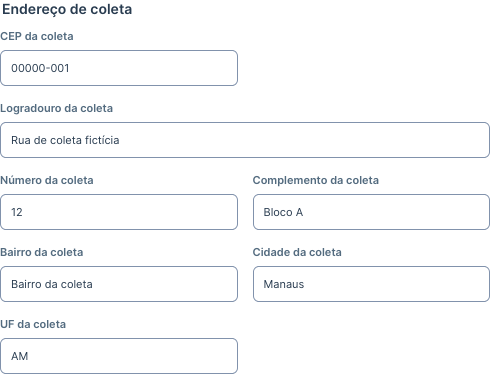
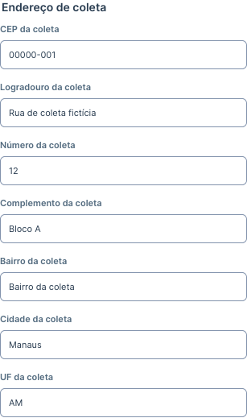
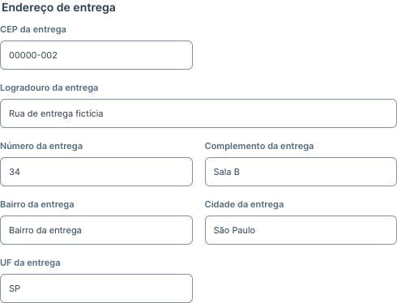
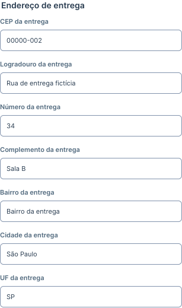

# Clientes — coleta e entrega estruturadas

Base: `6a5610ff15ad4cfcd810bf2028ab6bb48da5a1d3` (PR #9 integrado). Branch: `fix/customer-collection-delivery-addresses`. Risco nível 3: persistência e isolamento por identidade. A implementação foi corrigida porque a versão anterior acrescentava dois textos ao endereço genérico, resultando em três endereços visíveis.

## Experiência final

Para a conta ativa **sammya.admin**, com papel **admin**:

1. Informações do cliente: nome, documento, telefone, contato, e-mail e situação.
2. **Endereço de coleta**: CEP, logradouro, número, complemento, bairro, cidade e UF.
3. **Endereço de entrega**: os mesmos sete campos, independentes.
4. Tipo de serviço: Não informado, Local ou Interestadual.

São exatamente dois grupos com 14 inputs de endereço, sem os inputs genéricos nem caixas avulsas de endereço inicial/final ou de texto cadastral legado. Rótulos distinguem cada destino, como “CEP da coleta”. A grade, os controles opcionais, os limites e a UF em maiúsculas reaproveitam o padrão existente. A listagem personalizada identifica coleta/entrega sob o nome; o endereço cadastral e sua cidade não reaparecem como um terceiro endereço. Contato, telefone e e-mail permanecem visíveis, com telefone uma única vez.

Outras contas mantêm formulário e listagem genéricos. O backend continua verificando a identidade obtida da sessão, username exato e papel; conta inativa é recusada pela autenticação existente. Nenhuma nova permissão global foi criada.

Busca, paginação, relatórios e CSV mantêm os contratos do cadastro comum. Esta correção não acrescenta filtros ou exportações específicos de coleta/entrega.

## Persistência e compatibilidade

- **0012** adiciona 14 colunas opcionais representadas por strings vazias em `customer_service_details`, com prefixos `collection_` e `delivery_`. Mantém unicidade por cliente/usuário e todos os campos da 0011. A migração 0011 permanece byte a byte igual, SHA-256 `fa5ad42633b8e70d2f2350973242ee467f8357d76e6037f0fcde695c005f4c95`.
- A API exclusiva acrescenta `collection_address` e `delivery_address`, cada um com `postal_code`, `street`, `address_number`, `complement`, `neighborhood`, `city`, `state`. Limites: 9, 180, 30, 100, 100, 100 e 2 caracteres, iguais ao endereço genérico. Todos são opcionais; tipos de serviço e validações anteriores foram preservados.
- Atualizações parciais dos objetos preservam os demais campos; objeto omitido/null preserva o endereço. A limpeza exige strings explicitamente vazias. Coleta e entrega são salvas na transação existente, sem efeito no cadastro original.
- O formulário personalizado omite o endereço cadastral e `start_address`/`end_address` do payload. Para a conta autorizada, os campos comuns omitidos no PUT são preservados no servidor, inclusive alterações concorrentes feitas por outra conta. Os contratos de substituição do formulário genérico permanecem iguais.
- As respostas de outras contas omitem toda a extensão. Envios diretos válidos são recusados com 403 (sem sessão, 401); dados inválidos são recusados com 422. A tabela continua ligada ao ID autenticado, sem aceitar um proprietário fornecido pelo navegador.

## Aproveitamento dos dados anteriores

A migração deixa os novos campos vazios e não presume que o cadastro anterior é coleta ou entrega.

Dentro do grupo de coleta, “Conferir cadastro anterior para coleta” permite consultar a origem preservada e solicitar sua cópia. É necessária uma segunda ação, **Confirmar cópia para coleta**; cancelar mantém os campos vazios. Só há oferta de cópia quando a coleta está vazia. A confirmação copia apenas para coleta e direciona o foco ao seu CEP; cancelar volta o foco ao botão de origem.

Quando há campos estruturados anteriores, copia os sete valores conhecidos. Se houver somente texto cadastral com até 180 caracteres, a confirmação explica que ele será copiado **integralmente para o logradouro**, exigindo revisão/distribuição manual dos dados. Não há parsing de CEP/cidade. Texto maior permanece integralmente consultável e requer preenchimento manual, sem truncamento.

Os textos `start_address` e `end_address` da 0011 continuam intactos no SQLite/API e podem ser consultados em disclosures somente de leitura dentro da coleta e da entrega correspondentes. A usuária pode transcrever os dados relevantes para os campos estruturados; salvar o formulário não modifica essas anotações. Essas consultas não acrescentam outro conjunto de inputs de endereço.

## Testes e evidências

Somente fixtures fictícias e SQLite descartável. Nenhum banco persistente ou conta Railway foi consultado.

| Verificação | Resultado |
| --- | --- |
| `PYTHONPATH=backend .venv/bin/python -m pytest backend/tests/test_customer_details.py backend/tests/test_app.py backend/tests/test_deployment.py -q` | 104 aprovados: cadastro, isolamento, CSV, backup, autenticação, regressões existentes e saúde/migrações |
| `PYTHONPATH=backend .venv/bin/python -m pytest backend/tests/test_customer_details.py -k new_process -q` | 1 caso adicional aprovado: processo Python novo autentica e recupera os dois endereços completos e legados do mesmo SQLite |
| `cd frontend && npm run build && npm test` | TypeScript/Vite e 138 testes aprovados |
| `cd frontend && npx playwright test tests/customer-details.spec.ts --project=desktop --project=mobile` | 14 aprovados, Firefox em 1440×900 e 375×812, sem retries |
| `cd frontend && npx playwright test tests/app.spec.ts --project=desktop --grep 'cliente e produto persistem'` | 1 aprovado: cliente/produto, estoque, venda, recibo e estorno |

A migração 0011→0012 foi testada com cadastro original e textos antigos já preenchidos: tabelas/linhas anteriores preservadas, projeção de todas as colunas antigas da tabela complementar idêntica e 14 campos novos vazios. Upgrade repetido, integridade SQLite e FKs aprovados. As verificações incluem edição independente, nulidade/limites, recusa de outras contas, CSV idêntico, backup restaurado e leitura após reinício em processo independente.

Os E2E exigem exatamente dois grupos, sete inputs em cada, rótulos únicos e ausência dos controles antigos. Cobrem criação/edição/reload, tipo Local/Interestadual, cópia confirmada/cancelada, preservação de atualização cadastral concorrente, consulta de textos longos, foco, genericidade e telefone único. Documento/dialog sem excesso horizontal nos cenários verificados. Capturas reais dos grupos, preenchidos com dados fictícios, sem alteração da imagem:

| Desktop | Celular 375 px |
| --- | --- |
|  |  |
|  |  |

O aviso preexistente de depreciação Starlette/TestClient/httpx permanece. Leitor de tela real, dispositivo físico e avaliação humana não foram homologados nesta tarefa.

## Arquivos e revisão

- `backend/app/models.py`, `schemas.py`, `api.py`: representação estruturada e preservação dos campos omitidos da conta personalizada; autorização existente mantida.
- `backend/migrations/versions/0012_customer_structured_addresses.py`: alteração aditiva isolada.
- `frontend/src/catalog.tsx`, `types.ts`, `customerAddresses.ts`: dois grupos, fluxo de confirmação, histórico e listagem restrita.
- `frontend/src/styles.css`: 21 linhas limitadas a grupos/histórico dentro de `.silex-customers-page`.
- Testes de Clientes backend/E2E e `customerAddresses.test.ts`; este relatório e quatro capturas sintéticas.

A revisão verifica o diff, `git diff --check`, caminhos, ausência de dados privados/segredos, preservação da 0011, financeiro, CSV, dependências, autenticação e start. O baseline de fontes foi arquivado fora do projeto em diretório restrito; a restauração temporária conferiu 584 arquivos. Esse backup de código não substitui o backup operacional do SQLite.

## Cuidados para eventual Railway

**Sem merge, deploy ou migração Railway nesta tarefa.** Antes de uma publicação autorizada, exigir backup verificável e exportado do SQLite vigente (incluindo anexos BLOB), hash/integridade e possibilidade de restaurar o snapshot compatível, conforme o [guia operacional](../../deployment/RAILWAY.md#13-backup-e-recuperação). Não substituir o banco remoto por um banco local nem executar seed-demo.

Após aprovação, a inicialização existente executará a 0012 com o volume montado e uma réplica. Planejar janela supervisionada e conferir revisão/health, clientes antigos e os dois endereços com a conta real autorizada. Se houver falha, preservar o banco e diagnosticar antes de repetir; não apagar dados nem fazer downgrade automático. O downgrade remove os 14 campos novos e perderia seus valores. Retornar a imagem antiga exige compatibilidade de schema e decisão explícita sobre restauração, pois um snapshot anterior também reverte gravações comuns posteriores.
