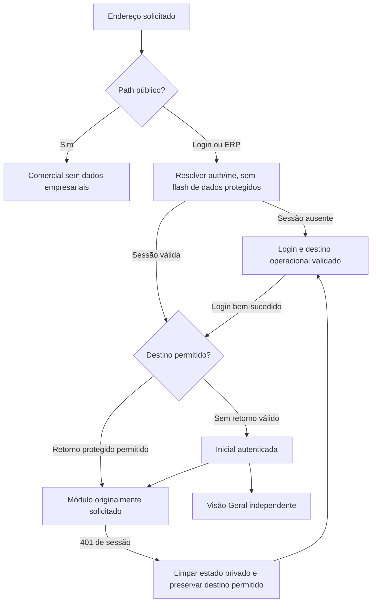

# Navegação e autenticação propostas

Planejamento; nenhum roteamento, cookie, autenticação ou permissão alterado no SB-01.

**Direção aprovada conceitualmente pelo usuário:** `/`, `/entrar`, `/app#home`, `/app#dashboard`, `/app#...` e compatibilidade dos hashes antigos. A implementação futura continua condicionada à autorização do SB-03 e aos testes de rotas, autenticação, autorização, histórico, sessão e logout previstos; aprovação de planejamento não é autorização para implementar.

## Alternativas

| Estratégia | Vantagem | Dependência/risco |
| --- | --- | --- |
| Tudo no mesmo hash com prefixos | Pouca alteração no ponto de entrada | Âncoras comerciais exigem interceptação; semântica pública/ERP continua acoplada |
| **Pathnames separados + hashes existentes no ERP** | **Separação clara; conserva destinos operacionais e evita conflito de âncoras** | **Dispatcher pathname/popstate, guard frontend e compatibilidade de links antigos** |
| Todas as rotas via History API/React Router | URLs uniformes e rotas aninhadas | Maior migração, dependência nova e rewrites; desnecessário para este ciclo visual |

Recomendada a segunda alternativa. O catchall atual de FastAPI já devolve index.html para paths não API quando o frontend é servido; validar Vite e servidor real antes de ativação. Novo código de navegação só em SB-03, com aprovação explícita, sem modificar endpoints/autorização do backend.

## Convenção proposta

| Endereço | Superfície | Sessão |
| --- | --- | --- |
| `/` | Comercial | Não exigida; pode ser visitada mesmo autenticado, sem dados privados |
| `/#modulos`, `/#demonstracao`, `/#beneficios` | Âncoras comerciais | Scroll nativo; não processadas como módulo ERP |
| `/entrar` | Login | Guest; autenticado segue retorno válido ou home |
| `/app#home` | Nova inicial autenticada | Obrigatória; `home` é nova reserva proposta, não identificador já existente |
| `/app#dashboard` | Visão Geral existente | Obrigatória |
| `/app#finance` e demais identificadores do inventário | Módulos operacionais | Obrigatória e respeita papel existente |
| `/app` | Entrada sem destino | Home após resolução da sessão |

Não reutilizar `#inicio` ou `#login`. A separação decorre de pathname e registro explícito, não de presumir que hashes nunca foram usados. Manter identificadores atuais dos módulos para limitar regressão. Um registro futuro de rotas deve conter id, título, grupo, componente, acesso atual e disponibilidade; derivar menu/atalhos/guard do mesmo registro. Não transformar esse registro em novo sistema de permissões.

Compatibilidade: em `/`, reconhecer apenas hashes operacionais antigos da allowlist e substituir endereço por `/app#id`, inclusive alias `finance-suppliers`. Âncoras comerciais reconhecidas permanecem públicas. Hash desconhecido na página pública permanece público; no ERP exibir destino não encontrado com caminho para home, sem renderizar módulo restrito. Não interpretar fragmentos como URLs de redirecionamento.

## Fluxos e sessão



1. Público: não buscar company-settings/dashboard/listas privadas. Sessão válida não impede visitar a página comercial; Entrar leva à área autenticada após resolução, sem exibir dados empresariais no cabeçalho público.
2. Rota protegida: resolver `/api/auth/me` antes de montar shell/home/módulos. Estado pendente mostra marca e loading neutro. Sem sessão, guardar somente identificador operacional reconhecido e navegar para login.
3. Retorno: armazenar metadado do destino em memória/sessionStorage da aba, sem dados empresariais, tokens ou credenciais. Recomenda-se registro `{id, origem: "protected-request"}`; não URL arbitrária nem parâmetro aberto. Revalidar allowlist e papel após login, consumir e apagar o retorno. Sem destino válido, home. Rotas não permitidas não devem ser abertas nem ganhar acesso por redirecionamento.
4. Sessão: conservar cookie `gestao_session` HttpOnly, SameSite=strict, path `/`, TTL atual 12h; nenhum token no navegador além do cookie gerenciado pelo servidor. Preservar `/auth/login`, `/auth/me`, `/auth/logout`. Segurança de cookie em HTTPS e hospedagem pertencem à trilha de preparação web, não SB-01.
5. Expiração: 401 em operação retira imediatamente shell, empresa e conteúdo privado da renderização; limpar caches de tela e dados em memória. Preservar somente rota permitida e informar “Sua sessão terminou. Entre novamente.” Ao retornar, refazer consultas; não restaurar formulários de pagamento automaticamente. 403 mantém usuário válido e comunica acesso restrito, sem converter para sessão expirada.
6. Logout explícito: executar POST existente; confirmado ou 401 indicando sessão já encerrada, limpar usuário/empresa/retorno e navegar ao público com replace. Falha de rede: retirar conteúdo privado da apresentação, informar que o encerramento no servidor não foi confirmado e oferecer nova tentativa; não afirmar sessão revogada. Nunca exibir empresa por fallback no público. Não zerar dados/configurações do cliente.
7. Histórico: pushState para deslocamentos voluntários entre superfícies, hash nativo para módulos; replaceState para normalização legado e redirects de guarda/login. Escutar popstate e hashchange; evitar dupla entrada. Voltar/avançar deve resolver autorização novamente, inclusive após logout. Não fazer replace de todas as navegações.
8. Acessibilidade: links reais para destinos; aria-current, pular ao conteúdo, foco no título após mudança deliberada; grupos com aria-expanded. Menu móvel fecha por Escape/backdrop, captura foco apenas quando aberto e devolve foco ao acionador. Não usar scroll de âncora pública para disparar guard operacional.

O plano modifica futuramente o destino e a organização de navegação do frontend, conforme pedido do usuário; mantém o mecanismo de autenticação e autorização existente. O comportamento tem aprovação conceitual; SB-03 requer autorização de implementação e evidência dos testes previstos. Não alegar que os protótipos validam esses fluxos, porque não têm sessão/API.

## Organização futura de componentes

```text
src/brand/Brand.tsx                 marca fixa e variantes oficiais
src/styles/tokens.css              tokens consolidados
src/navigation/routes.ts           registro de destinos existentes
src/navigation/navigation.ts       pathname/hash/histórico/retorno allowlist
src/auth/SessionBoundary.tsx        coordena estados atuais sem novo endpoint
src/layout/PublicLayout.tsx        cabeçalho e rodapé públicos
src/layout/AppShell.tsx            menu/topbar/empresa/usuário existentes
src/pages/PublicHome.tsx           apresentação pública
src/pages/AuthenticatedHome.tsx    entrada autenticada
App.tsx                            dispatcher, mantém páginas operacionais
```

Nomes/arquivos são propostos, não criados em produção. Login pode ser extraído em `pages/LoginPage.tsx` preservando formulário, validação e contrato atuais. DashboardPage pode permanecer inicialmente no App para reduzir o diff.

## Página pública

PublicLayout contém logo clara oficial, navegação por seções e Entrar. PublicHome contém proposta de centralização da gestão, módulos homologados, visual ilustrativo independente, benefícios verificáveis e CTA para login. Nenhum cadastro comercial/contratação. Demonstração usa fixture local fictícia: hero financeiro e segunda seção de Vendas (número/cliente, data/pagamento, total, situação e detalhe presentes em SalesPage), sem novo indicador; nunca chamar `/dashboard`, `/company-settings`, dados de usuário ou lista de títulos. Não usar screenshot privado como marketing.

Texto proposto: “Sua empresa, organizada em um só lugar.” Benefícios: organizar cadastros, consultar vendas/estoque e acompanhar entradas/saídas. Evitar métricas de ganho não medidas, clientes/depoimentos inventados, integrações fiscais/bancárias automáticas, planos/preços/SLA. Publicação do conteúdo depende de homologação e aprovação comercial separadas.

## Inicial autenticada

AppShell existente, com marca fixa e empresa em região própria. Precedência e limites de brand_name/company_name em [DADOS-APRESENTACAO.md](DADOS-APRESENTACAO.md); não interpretar a antiga marca do produto como nome empresarial. Home mostra empresa ativa configurada (company_name, company_document, phone, email, address disponíveis; campos vazios não inventados), usuário/papel da sessão e atalhos derivados da allowlist por papel. Não há selector de empresas no backend atual; o mockup exibe identificação, não seleção fictícia.

Atalhos A: Visão Geral, Frente de Caixa, Vendas, Clientes, Produtos/Serviços, Estoque, Lançamentos, Pagar/Receber, Serviços/pedidos. Atalhos O: Visão Geral, Frente de Caixa, Vendas, Clientes, Produtos/Serviços, Controle de caixa. Cadastros de prestadores/PIX administrativos não aparecem ao operador. Um cartão com descrição de módulo não pode sugerir acesso indisponível: filtrar também cartões.

Informação operacional inicial: nome do usuário, papel e data; opcional indicador de estado do caixa apenas se reutilizar o dado já autorizado, sem novos cálculos. Recomenda-se primeira versão sem indicadores monetários. Indicadores, últimas vendas, alertas de estoque, consultas, ações e filtros continuam na Visão Geral; links apenas, sem duplicação integral.

## Lançamentos — fronteira visual

Manter períodos, quatro indicadores existentes, contas com saldos atuais que incluem histórico/saldo inicial, filtros, base lançamento/competência, datas, pesquisar, impressão, exportação CSV, criação de receita/despesa e estorno permitido. Não adicionar “Enviar” porque não existe no Ledger atual, embora apareça na referência ControlMax.

Campos da tabela atuais: data/competência, histórico/documento, conta/categoria, origem, valor e ações. Preservar origem manual/título/venda/OFX/estorno e disponibilidade de estorno apenas nas condições atuais. Um título em aberto não representa movimento efetivo; home ou nova aparência não podem mudar essa distinção.

Nova despesa será secundária/neutra; valores de entrada/saída mantêm semânticas distintas. Datas visíveis dd/mm/aaaa com mesmo ISO e bases; proposta de DateField compartilhado em [DADOS-APRESENTACAO.md](DADOS-APRESENTACAO.md). Tabela com orientação de scroll em tablet/celular, preservando todas as colunas e ações.

## Revisão técnica antes de implementar

Aprovar os rótulos/precedência conservadora do campo legado brand_name; validar tratamento de logout com falha de rede e acesso direto nos ambientes Vite/FastAPI/hosting. Paths e identificador home já aprovados conceitualmente. Conservar chaves técnicas existentes. Primeiro provar redirects/guard/histórico em banco de teste separado; depois integrar as duas páginas. O SB-01 não faz essas alterações nem executa esses testes.
